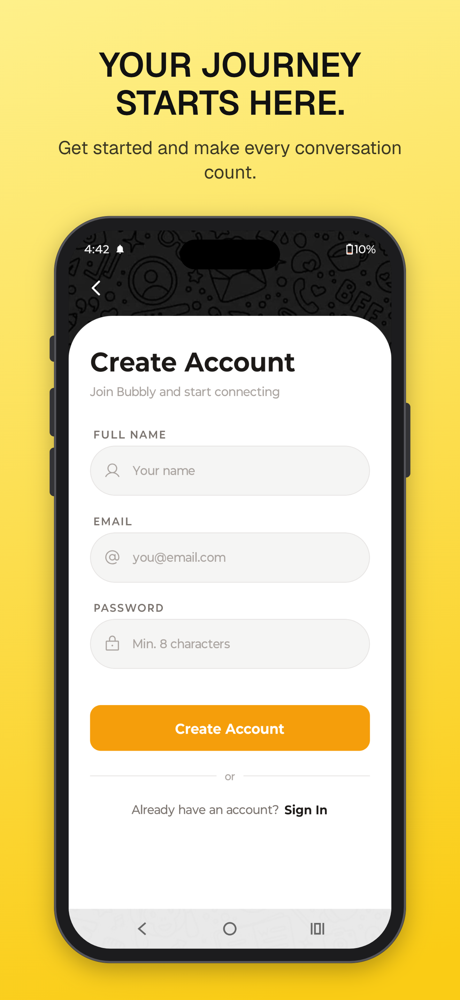
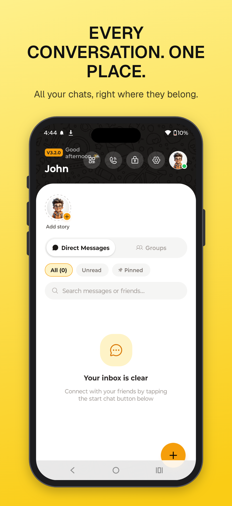
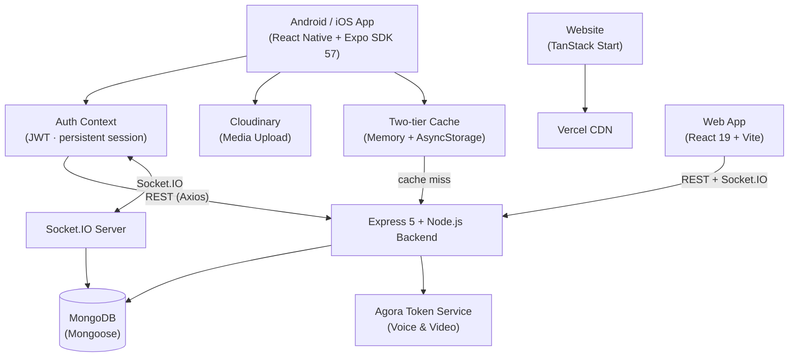
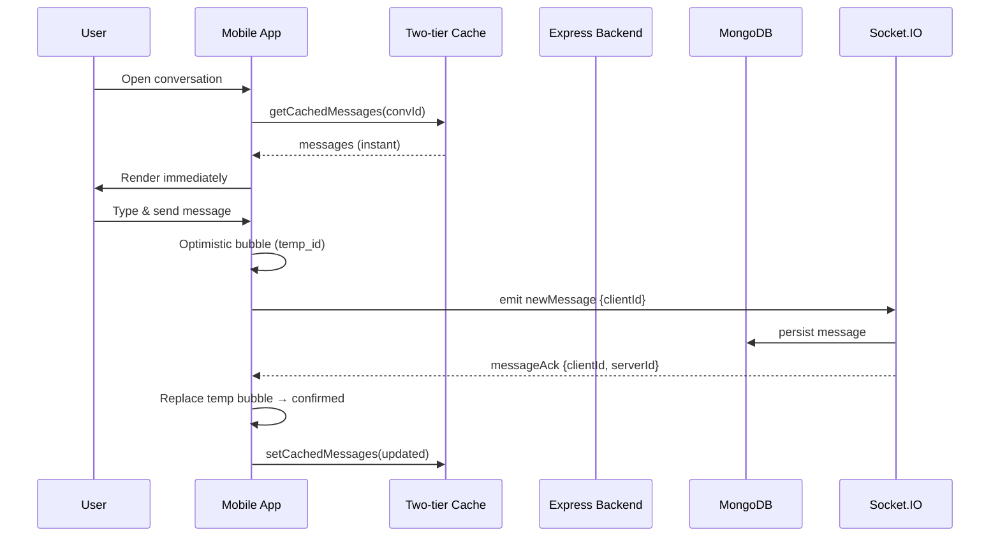

# Bubbly 💛

### Connect Beyond Messages

A full‑stack, real‑time messaging application for conversations, groups, stories, media sharing, GIFs, and audio/video communication — built with React Native, Expo, Node.js, and Socket.IO.

---

<p align="center">
  <a href="https://github.com/Tanjiro-77/bubbly-chatapp"></a>
  <a href="https://bubbly-chatapp.vercel.app/"></a>
  <a href="https://github.com/Tanjiro-77/bubbly-chatapp/releases/latest"></a>
</p>

<p align="center">
  
  
  
  
  
  
  
</p>

---

## ✨ What's New in v4.1.5

> [!IMPORTANT]
> v4.1.5 is the most significant performance and UX release since launch. It introduces a two-tier caching architecture, instant optimistic messaging, GIF support, a smart invite system, and a credential-completion flow for existing users.

### 🚀 Performance & Caching

| Improvement | Detail |
|---|---|
| **Two-tier chat cache** | In-memory + AsyncStorage cache (`chatCache.ts`) for conversations, messages, contacts, and stories. Cache-first rendering eliminates cold-start flicker. |
| **Instant optimistic messaging** | Text and GIF messages appear immediately with a `temp_` bubble and `clientId`. Server confirms via `messageAck`; failures auto-rollback the bubble. |
| **Feature storage memory layer** | All 10 feature stores (quick replies, nicknames, notes, tags, focus mode, custom status, appearance, privacy shield, archived, silent IDs) now backed by an in-memory cache — zero repeated AsyncStorage reads per session. |
| **FlatList tuning** | `initialNumToRender`, `maxToRenderPerBatch`, `windowSize`, `removeClippedSubviews` all tuned in Home and Conversation screens. |
| **Socket reconnect** | Faster back-off: 450 ms → 900 ms → 1 800 ms → 3 000 ms (max). Connect wait reduced to 3 500 ms. |
| **No forced re-login** | Session token expiry removed — users stay logged in indefinitely. |

### 💬 Messaging

- **GIF support** — browse and send animated GIFs inline; instant optimistic preview before server confirmation.
- **Optimistic text send** — zero perceived latency for outgoing messages.
- **Debounced draft save** — keystrokes debounced at 320 ms; no lag while typing.
- **Date separators** — smart local date labels (`chatCache.ts`: `formatSeparatorDateLabel`, `getLocalDateKey`).
- **12-hour time formatting** — `formatTime12h` replaces Moment.js for smaller bundle and faster rendering.

### 🤝 Smart Invite System

- **`InviteSheetModal`** — rich bottom sheet with SMS, WhatsApp, system Share, and copy-to-clipboard actions.
- **Three tone presets** — Friendly, Quick, HD Calls — each with a distinct editable message template.
- **Personal invite link** — `https://bubbly.app/u/<userId>` auto-generated per user.
- **Invite from New Conversation** — unregistered phone contacts show an "Invite via Link/SMS" button; invited numbers are tracked to avoid duplicate prompts.
- **Invite from Profile** — "Invite Friends" action card in the profile modal opens the invite sheet.

### 🔐 Credential Completion Flow

- **`ContactCompletionModal`** — dynamic in-app overlay shown once to existing users who registered via email (needs phone) or phone (needs email).
- **Adaptive `completeProfile` screen** — shows only the missing field (phone OR email) with a personalised title and icon.
- **Smart routing** — `NavigationGuard` in `_layout.tsx` detects `needsContactCompletion` and redirects before the main app loads.

### 🎨 UI / UX Polish

| Component | Change |
|---|---|
| **Button** | Reanimated spring press-scale animation (0.968); `React.memo` |
| **Input** | Focus glow + amber border highlight state |
| **Typo** | `React.memo`, memoised style, `maxFontSizeMultiplier={1.3}` |
| **BackButton** | `React.memo`, `hitSlop`, safe `router.canGoBack()` guard |
| **ScreenWrapper** | Smart status-bar style detection, correct modal safe-area padding |
| **Splash Screen** | Upgraded amber gradient animation with staggered logo entrance |
| **Route transitions** | `slide_from_right` animation + dark `contentStyle` for all navigations |
| **Auth screens** | Faster animation durations, keyboard chain hints (`returnKeyType`, `autoComplete`) |

---

## Table of Contents

- [About Bubbly](#about-bubbly)
- [Application Screenshots](#application-screenshots)
- [Features](#features)
  - [Accounts & Profiles](#accounts--profiles)
  - [Home Dashboard & Conversations](#home-dashboard--conversations)
  - [Messaging](#messaging)
  - [GIF Support](#gif-support)
  - [Smart Invite System](#smart-invite-system)
  - [Credential Completion Flow](#credential-completion-flow)
  - [Groups](#groups)
  - [Stories & Story Studio](#stories--story-studio)
  - [Voice & Video Calls](#voice--video-calls)
  - [Permissions & Onboarding](#permissions--onboarding)
  - [Design & Mobile Experience](#design--mobile-experience)
  - [Performance & Caching](#performance--caching)
- [Technology Stack](#technology-stack)
- [Application Architecture](#application-architecture)
- [Project Structure](#project-structure)
- [Getting Started](#getting-started)
- [Environment Configuration](#environment-configuration)
- [Available Scripts](#available-scripts)
- [API Overview](#api-overview)
- [Real‑time Communication](#real-time-communication)
- [Build & Distribution](#build--distribution)
- [Verification](#verification)
- [Security](#security)
- [Contributing](#contributing)
- [Reporting an Issue](#reporting-an-issue)
- [License](#license)
- [Developer](#developer)

---

## About Bubbly

**Bubbly** is a mobile‑first, full‑stack messaging application built to bring everyday communication into one connected experience. It combines private conversations, group chats, stories, GIFs, media sharing, voice messages, and audio/video calls — all in a single application.

The repository contains four connected parts:

| Part | Description |
|---|---|
| **Mobile app** | Cross-platform Android & iOS built with React Native & Expo SDK 57 |
| **Web app** | Real-time desktop & mobile browser experience built with React 19, TypeScript, Vite, Tailwind CSS |
| **Backend** | Node.js / Express 5 server with MongoDB and Socket.IO |
| **Website** | Marketing landing page built with React, TypeScript, Vite, and TanStack Start |

> [!NOTE]
> The mobile app follows a **Honey Amber** visual identity: warm stone-900 backgrounds, amber-400 accents, and clear Inter typography. Both light and dark themes are fully supported.

---

## Application Screenshots

<p align="center">
  
  
  
  
  
</p>
<p align="center">
  
  
  
  
  
</p>

---

## Features

### Accounts & Profiles

- Registration via **phone number** (required) **and email** (required) — both fields are enforced at sign-up and profile completion.
- JWT authentication with persistent sessions (no forced re-login).
- Secure password hashing with bcrypt.
- Avatar upload, profile editing, linked-account display.
- **Custom status pill** — set a short status message shown beside your name.
- **Focus / Quiet mode** — pause notifications without signing out.
- **Privacy Shield** — control who sees your last seen, avatar, and status.
- **Chat Vault / App Lock** — secure individual chats or the whole app with biometrics / PIN.
- Quick access shortcuts: Settings, How-to-Use, About, Sign-Out.
- **"Invite Friends"** action card in the profile modal opens the full invite sheet.

### Home Dashboard & Conversations

- Time-aware greeting.
- Separate **Direct** and **Groups** views.
- Filters: All, Unread, Pinned, Tagged.
- **Cache-first rendering** — conversations load instantly from in-memory cache; network refresh happens silently in the background.
- **Pull-to-refresh** with `RefreshControl` for explicit updates.
- Unread count badges, conversation counters.
- Search with result count.
- FAB for new conversation / group creation.
- Story bar with gradient rings for unseen stories.
- Message preview indicators (sent ✓, delivered ✓✓, read 💛✓✓).
- Live online presence on avatars.
- **Chat folders / tags** — organise conversations by label.
- **Archived chats** — hide conversations without deleting.
- **Starred messages** — bookmark important messages across chats.
- **QR code / Invite** — share your Bubbly profile link via QR.

### Messaging

- Real-time one-to-one & group chats via Socket.IO.
- Delivery & read receipts.
- **Instant optimistic send** — message appears immediately at 0 ms perceived latency; `messageAck` confirms or rolls back.
- Swipe-to-reply with haptic feedback.
- Media attachments, voice notes, voice-playback speed (1×, 1.5×, 2×).
- Inline translation to Spanish.
- In-chat search with navigation.
- Pinned & saved messages.
- Scheduled messages (background processing).
- Double-tap heart reaction with animation.
- Discard voice recording before send.
- **Disappearing messages** — auto-delete after a configurable timer.
- **View-once media** — photos/videos that disappear after one view.
- **Polls** — create in-chat polls with multiple options.
- **Checklists** — shared task lists inside a conversation.
- **Location sharing** — send your current location as a map pin.
- **Rich cards** — countdown timers and interactive game cards.
- **Smart date separators** — localised date labels between message groups.
- **Debounced draft save** — draft persists with 320 ms debounce; no typing lag.
- Connection status feedback.

### GIF Support

- **GIF picker modal** (`GifPickerModal.tsx`) integrated into the conversation composer.
- Browse trending and searched GIFs.
- **Optimistic GIF send** — animated preview appears immediately in the bubble before server confirmation.
- Rendered natively via Expo Image with format-aware handling.

### Smart Invite System

Bubbly makes growing your network effortless with a fully redesigned invite experience.

| Action | Detail |
|---|---|
| **SMS invite** | Pre-filled text with your personal link, opens native SMS composer |
| **WhatsApp invite** | Deep-links into WhatsApp with the invite message |
| **System Share** | Opens the OS share sheet for any other app |
| **Copy invite link** | Copies `https://bubbly.app/u/<userId>` to clipboard via `expo-clipboard` |
| **Copy invite text** | Copies the full formatted message |
| **Tone presets** | Friendly 😊 · Quick ⚡ · HD Calls 📹 — each with a distinct editable template |
| **Editable preview** | Full live preview of the invite message before sending |

The invite sheet can be opened from:
1. **New Conversation Modal** — per-contact invite button for unregistered numbers; "Invite a friend" banner.
2. **Profile Modal** — "Invite Friends" action card.

### Credential Completion Flow

> [!IMPORTANT]
> Bubbly syncs contacts by **phone number**. Email is used for account recovery and notification delivery. Both are required for all users. The credential-completion flow ensures legacy accounts are updated gracefully.

- **`ContactCompletionModal`** — shown as a non-dismissible overlay the first time a user opens the app after upgrading, if their account is missing phone or email.
- Logic is **per-user and directional**:
  - Registered via email → prompted to add phone number.
  - Registered via phone → prompted to add email address.
- **Adaptive `completeProfile` screen** — displays only the missing field with a personalised title, icon, and copy. Users are never shown a field they already have.
- Once completed, the modal never appears again (tracked in AsyncStorage).

### Groups

- Create groups, search contacts, multi-select participants.
- Group avatar, admins, configurable permissions.
- Group description, system messages.
- Shared gallery (Media / Docs / Links tabs).

### Stories & Story Studio

- Text & photo stories, caption editing.
- Seven background presets (Sunset Amber, Midnight Neon, …).
- Alignment controls, character counter.
- Emoji reactions, viewer count & list.
- Gradient rings for unseen stories, pause on press.
- **Cache-first story bar** — stories load from `getCachedStories` before network refresh.

### Voice & Video Calls

- Agora-powered voice & video calls.
- Incoming call handling with full-screen notification: accept / reject / cancel.
- In-call mute, speaker, end controls.
- Animated avatar effects, call-quality indicator.
- Floating video preview, camera-flip shortcut.
- Call history and resource cleanup.
- Multiple custom ringtones (`incoming_call.mp3` → `incoming_call_4.mp3`).

### Permissions & Onboarding

- Multi-stage onboarding, native permission requests (Camera, Mic, Media, Notifications, Contacts).
- "Skip for now" flow, settings shortcut for denied permissions.
- Persistent onboarding state across restarts.

### Design & Mobile Experience

- Consistent spacing, typography, corner radii, shadows.
- **Animated splash screen** — staggered amber gradient logo entrance.
- **Route transitions** — `slide_from_right` with dark `contentStyle`.
- **Reanimated spring press** on Button (scale 0.968).
- **Input focus glow** — amber border highlight on active inputs.
- Memoisation (`React.memo`, `useMemo`, `useCallback`) across all list-item components.
- Robust keyboard handling, Android back-button support.
- Custom deep-link scheme `bubbly://` and `com.arnav5569.chat://`.
- `maxFontSizeMultiplier={1.3}` enforced on all Typo components for safe accessibility scaling.

### Performance & Caching

```
Request path (v4.1.5)
─────────────────────
Screen mounts
  └─▶ read in-memory cache (0 ms)
        ├─ HIT  → render immediately, refresh in background
        └─ MISS → read AsyncStorage (~2–8 ms)
                    ├─ HIT  → render, write to in-memory, refresh in background
                    └─ MISS → fetch from server, write both tiers
```

| Cache key | In-memory TTL | AsyncStorage TTL |
|---|---|---|
| Conversations list | Session | Persistent |
| Messages per conversation | Session | Persistent |
| Contacts list | Session | Persistent |
| Stories | Session | Persistent |
| Feature stores (×10) | Session | Persistent |

---

## Technology Stack

| Layer | Technology |
|---|---|
| **Mobile framework** | React Native |
| **Mobile development** | Expo SDK 57 |
| **Navigation** | Expo Router (file-based, typed routes) |
| **Language** | TypeScript (strict) |
| **UI & animations** | React Native + Reanimated 3 |
| **Clipboard** | expo-clipboard |
| **Audio** | expo-audio |
| **Image selection** | expo-image-picker |
| **Notifications** | expo-notifications (foreground + background) |
| **Contacts sync** | expo-contacts |
| **API communication** | Axios |
| **Real-time client** | Socket.IO Client |
| **Local persistence** | AsyncStorage (two-tier with in-memory cache) |
| **Error tracking** | Sentry (`@sentry/react-native`) |
| **Backend runtime** | Node.js |
| **Backend framework** | Express 5 |
| **Database** | MongoDB |
| **ODM** | Mongoose |
| **Real-time server** | Socket.IO |
| **Authentication** | JSON Web Tokens (persistent, no forced expiry) |
| **Password hashing** | bcryptjs |
| **Voice & video** | Agora |
| **Media storage** | Cloudinary |
| **Mobile builds** | Expo Application Services (EAS) |
| **Website framework** | TanStack Start & React |
| **Website tooling** | Vite & TypeScript |
| **Web app** | React 19, Vite, Tailwind CSS |

---

## Application Architecture



### Data & Messaging Flow



---

## Project Structure

```text
bubbly/
├── backend/
│   ├── config/
│   │   └── db.ts                        # MongoDB connection
│   ├── controllers/
│   │   ├── auth.controller.ts
│   │   ├── call.controller.ts
│   │   └── search.controller.ts
│   ├── middleware/
│   │   └── auth.ts                      # JWT verification middleware
│   ├── models/
│   │   ├── Call.ts
│   │   ├── Conversation.ts
│   │   ├── Message.ts
│   │   ├── Report.ts
│   │   ├── SavedMessage.ts
│   │   ├── ScheduledMessage.ts
│   │   ├── Story.ts
│   │   ├── TranslationCache.ts
│   │   └── User.ts
│   ├── routes/
│   │   ├── app.routes.ts
│   │   └── auth.routes.ts
│   ├── services/
│   │   ├── messageService.ts
│   │   └── scheduledWorker.ts           # Scheduled message background worker
│   ├── socket/
│   │   ├── appEvents.ts
│   │   ├── callEvents.ts
│   │   ├── chatEvents.ts
│   │   ├── groupEvents.ts
│   │   ├── io.ts
│   │   ├── socket.ts
│   │   └── useEvents.ts
│   ├── utils/
│   │   ├── messageFormat.ts
│   │   ├── permissions.ts
│   │   ├── rateLimit.ts
│   │   └── token.ts
│   ├── index.ts
│   └── package.json
│
├── frontend/
│   ├── app/
│   │   ├── (auth)/
│   │   │   ├── completeProfile.tsx      # ✨ NEW — adaptive missing-field form
│   │   │   ├── login.tsx
│   │   │   ├── register.tsx
│   │   │   └── welcome.tsx
│   │   ├── (main)/
│   │   │   ├── about.tsx
│   │   │   ├── callScreen.tsx
│   │   │   ├── conversation.tsx         # ✨ Optimistic send, GIF, cache
│   │   │   ├── createStory.tsx
│   │   │   ├── home.tsx                 # ✨ Cache-first, pull-to-refresh
│   │   │   ├── incomingCall.tsx
│   │   │   ├── newConversationModal.tsx # ✨ Invite sheet, unregistered flow
│   │   │   ├── onboarding.tsx
│   │   │   ├── profileModel.tsx         # ✨ Invite Friends action
│   │   │   ├── qrCode.tsx
│   │   │   ├── settings.tsx
│   │   │   └── storyViewer.tsx
│   │   ├── _layout.tsx                  # ✨ slide_from_right, ContactCompletionModal
│   │   └── index.tsx
│   ├── components/
│   │   ├── AppLockGate.tsx
│   │   ├── AuthLegalFooter.tsx
│   │   ├── Avatar.tsx
│   │   ├── BackButton.tsx               # ✨ React.memo, hitSlop, safe canGoBack
│   │   ├── BrandIcon.tsx
│   │   ├── BubblyAlert.tsx
│   │   ├── Button.tsx                   # ✨ Reanimated spring press
│   │   ├── ContactCompletionModal.tsx   # ✨ NEW — per-user credential prompt
│   │   ├── ConversationFeatureModals.tsx
│   │   ├── ConversationItem.tsx         # ✨ chatCache date formatter
│   │   ├── ErrorBoundary.tsx
│   │   ├── FormattedText.tsx
│   │   ├── GifPickerModal.tsx           # ✨ GIF picker & send
│   │   ├── GoogleIcon.tsx
│   │   ├── Header.tsx
│   │   ├── Input.tsx                    # ✨ Focus glow
│   │   ├── InviteSheetModal.tsx         # ✨ NEW — full invite bottom sheet
│   │   ├── LegalDocumentView.tsx
│   │   ├── Loading.tsx
│   │   ├── MessageItem.tsx              # ✨ React.memo, 12h time formatter
│   │   ├── RealtimeNotifier.tsx
│   │   ├── RichChatFeatures.tsx
│   │   ├── ScreenWrapper.tsx            # ✨ Smart status-bar, modal padding
│   │   ├── StoryBar.tsx                 # ✨ Cache-first stories
│   │   └── Typo.tsx                     # ✨ React.memo, maxFontSizeMultiplier
│   ├── constants/
│   ├── contexts/
│   │   └── authContext.tsx              # ✨ useCallback/useMemo, session, routing
│   ├── hooks/
│   ├── services/
│   │   ├── contactService.ts
│   │   └── notificationService.ts
│   ├── socket/
│   │   └── socket.ts                    # ✨ Faster reconnect back-off
│   ├── utils/
│   │   ├── chatCache.ts                 # ✨ NEW — two-tier cache + date helpers
│   │   ├── featureStorage.ts            # ✨ Memory cache layer for all 10 stores
│   │   ├── haptics.ts
│   │   └── styling.ts
│   ├── assets/
│   │   ├── audio/
│   │   │   ├── incoming_call.mp3
│   │   │   └── notification.mp3
│   │   └── images/
│   ├── app.json                         # version: 4.1.5
│   ├── eas.json
│   └── package.json
│
├── website/
│   ├── public/
│   └── src/
│       ├── components/
│       ├── hooks/
│       ├── lib/
│       ├── routes/
│       └── styles.css
│
├── web/
│   └── ...
│
├── screenshots/
│   ├── 01.png … 10.png
├── .gitignore
├── file-tree.txt
└── README.md
```

---

## Getting Started

### Prerequisites

- **Node.js** ≥ 18 & npm
- **Git**
- **MongoDB** (local or Atlas)
- **Expo CLI** (`npm i -g expo-cli`)
- Android emulator / physical device  
  _(iOS builds require macOS + Xcode)_
- Agora, Cloudinary & Sentry credentials

### 1 — Clone the repository

```bash
git clone https://github.com/Tanjiro-77/bubbly-chatapp.git
cd bubbly-chatapp
```

### 2 — Backend

```bash
cd backend
npm install
# create backend/.env (see Environment Configuration)
npm run dev      # development  (ts-node-dev)
# or
npm start        # production
```

### 3 — Mobile app

```bash
cd frontend
npm install
# create frontend/.env (see Environment Configuration)
npx expo start
# Press 'a' for Android, 'i' for iOS
```

### 4 — Website

```bash
cd website
npm install
npm run dev
```

### 5 — Web app _(optional)_

```bash
cd web
npm install
npm run dev
```

> [!TIP]
> Run the backend first so the mobile app can connect on startup. Use your machine's local IP (not `localhost`) in `EXPO_PUBLIC_API_URL` when testing on a physical device.

---

## Environment Configuration

### Backend — `backend/.env`

```env
PORT=3000
MONGO_URI=your_mongodb_connection_string
JWT_SECRET=your_long_random_secret

# Agora (voice & video calls)
AGORA_APP_ID=your_agora_app_id
AGORA_APP_CERTIFICATE=your_agora_app_certificate

# Cloudinary (media uploads)
CLOUDINARY_CLOUD_NAME=your_cloud_name
CLOUDINARY_API_KEY=your_api_key
CLOUDINARY_API_SECRET=your_api_secret
```

### Mobile — `frontend/.env`

```env
EXPO_PUBLIC_API_URL=http://YOUR_LOCAL_IP:3000
```

> [!CAUTION]
> `EXPO_PUBLIC_` variables are bundled into the client binary. Never put secrets (JWT_SECRET, Cloudinary API secret, Agora certificate) in `frontend/.env`.

---

## Available Scripts

### Frontend

| Command | Purpose |
|---|---|
| `npm start` | Start Expo dev tooling |
| `npm run android` | Launch Android emulator |
| `npm run ios` | Launch iOS simulator |
| `npm run web` | Start web dev server |
| `npm run lint` | Run ESLint |
| `npx tsc --noEmit` | TypeScript type-check (0 errors) |

### Backend

| Command | Purpose |
|---|---|
| `npm run dev` | Start backend in dev mode (ts-node-dev) |
| `npm start` | Start production server |
| `npm test` | Run test suite |

### Website

| Command | Purpose |
|---|---|
| `npm run dev` | Start dev server |
| `npm run build` | Build for production |

### Web Application

| Command | Purpose |
|---|---|
| `npm run dev` | Start Vite dev server |
| `npm run build` | Compile & bundle |
| `npm run preview` | Preview production build |

---

## API Overview

### Authentication — `/auth`

| Method | Endpoint | Description |
|---|---|---|
| `POST` | `/auth/register` | Register new user (email + phone required) |
| `POST` | `/auth/login` | Authenticate existing user |

### User — `/api/user`

| Method | Endpoint | Description |
|---|---|---|
| `PATCH` | `/api/user/phone` | Add / update phone number |
| `PATCH` | `/api/user/email` | Add / update email address |
| `GET` | `/api/user/:id` | Get user profile |

### Contacts — `/api/contacts`

| Method | Endpoint | Description |
|---|---|---|
| `POST` | `/api/contacts/sync` | Sync device contacts, return registered users |
| `GET` | `/api/contacts/find` | Find user by phone or email |

### Messaging & App — `/api`

| Method | Endpoint | Description |
|---|---|---|
| `GET` | `/api/search` | Search users, conversations, messages |
| `POST` | `/api/translate` | Translate message text |
| `POST` | `/api/call/token` | Generate Agora RTC token |
| `GET` | `/api/call/history` | Retrieve call history |

### Stories — `/api/stories`

| Method | Endpoint | Description |
|---|---|---|
| `POST` | `/api/stories` | Create a new story |
| `GET` | `/api/stories` | Get stories feed |
| `POST` | `/api/stories/:id/react` | React to a story |
| `GET` | `/api/stories/:id/viewers` | Get story viewer list |

### Saved Messages — `/api/saved-messages`

| Method | Endpoint | Description |
|---|---|---|
| `GET` | `/api/saved-messages` | Get all saved messages |
| `POST` | `/api/saved-messages` | Save a message |
| `DELETE` | `/api/saved-messages/:id` | Remove a saved message |

### Reports — `/api/reports`

| Method | Endpoint | Description |
|---|---|---|
| `POST` | `/api/reports` | Submit a user / message report |

---

## Real‑time Communication

Socket.IO powers Bubbly's real-time layer. The client reconnects with an exponential back-off (450 ms → 3 000 ms max) and a 3 500 ms connect timeout.

| Module | Responsibility |
|---|---|
| `chatEvents.ts` | Conversation & messaging (send, ack, read receipt, typing) |
| `groupEvents.ts` | Group creation, member management, permissions |
| `callEvents.ts` | Call lifecycle: invite → accept / reject → end |
| `appEvents.ts` | Application-level events (presence, story updates) |
| `io.ts` | Socket room utilities |
| `socket.ts` | Server initialization & middleware |

### Key Socket Events

| Event | Direction | Description |
|---|---|---|
| `newMessage` | client → server | Send a message (text, GIF, media, voice) |
| `messageAck` | server → client | Confirm delivery + assign server ID |
| `messagesRead` | client → server | Mark messages as read |
| `typing` | bidirectional | Typing indicator |
| `groupUpdated` | server → client | Group metadata change |
| `call:invite` | server → client | Incoming call notification |
| `call:end` | bidirectional | End an active call |
| `storyReaction` | client → server | React to a story |

---

## Build & Distribution

### Android APK (sideload)

```bash
eas build --platform android --profile production-apk
```

### Android AAB (Play Store)

```bash
eas build --platform android --profile production
```

### iOS

```bash
eas build --platform ios --profile production
```

> [!NOTE]
> iOS builds require Apple Developer signing configuration in `eas.json`. The app bundle ID is `com.arnav5569.chat`, build number `10`, version code `11`.

### OTA Updates

Bubbly is configured for Expo OTA updates (`runtimeVersion: appVersion`). Push JS-layer updates without a full store release:

```bash
eas update --branch production --message "v4.1.5 hotfix"
```

---

## Verification

| Check | Result |
|---|---|
| Frontend TypeScript (`tsc --noEmit`) | ✅ Passed — 0 errors |
| Backend TypeScript | ✅ Passed — 0 errors |
| Backend test suite | ✅ Passed — 15 tests |
| Website TypeScript | ✅ Passed — 0 errors |
| App version | `4.1.5` (Android versionCode 11, iOS build 10) |

---

## Security

- Keep all `.env` files out of version control (`.gitignore` enforced).
- Never expose `JWT_SECRET`, MongoDB credentials, Cloudinary API secret, or Agora certificate.
- Use HTTPS in production for all API and Socket.IO traffic.
- Enforce auth & authorisation middleware on every protected endpoint.
- Phone number and email are both required; neither can be omitted at registration or profile completion.
- Scrub logs and screenshots of personally identifiable information before sharing.
- Rate limiting applied to auth and translation endpoints (`rateLimit.ts`).

---

## Contributing

1. Fork the repository.
2. Create a feature branch (`git checkout -b feat/your-feature`).
3. Implement & test your changes.
4. Run `npx tsc --noEmit` in `frontend/` and ensure 0 errors.
5. Commit with a clear, descriptive message.
6. Open a Pull Request describing the motivation and change.

For major features or breaking changes, open an issue first to discuss the approach.

---

## Reporting an Issue

Include the following when filing a bug report:

- Expected vs actual behaviour.
- Steps to reproduce (minimal reproduction preferred).
- Error messages & stack traces.
- Device model, OS version, and Bubbly version (`4.1.5`).

Submit via the [GitHub Issues page](https://github.com/Tanjiro-77/bubbly-chatapp/issues).

---

## License

Refer to the license files in `backend/` and `frontend/` for applicable terms.

---

## Developer

<div align="center">

### Arnav Khari

Creator and sole developer of Bubbly.

[GitHub Profile](https://github.com/Tanjiro-77) · [Source Repository](https://github.com/Tanjiro-77/bubbly-chatapp) · [Project Website](https://bubbly-chatapp.vercel.app/)

**Built with 💛, curiosity, and a lot of code.**

_Bubbly — Connect Beyond Messages._

</div>
