# Bubbly 💛

### Connect Beyond Messages.

A full-stack, real-time messaging application for conversations, groups, stories, media sharing, and audio/video communication.

<p align="center">
  <a href="https://github.com/Tanjiro-77/bubbly-chatapp">
    
  </a>
  <a href="https://bubbly-chatapp.vercel.app/">
    
  </a>
  <a href="https://github.com/Tanjiro-77/bubbly-chatapp/releases/latest">
    
  </a>
</p>

<p align="center">
  
  
  
  
</p>

---

## Table of contents

- [About Bubbly](#about-bubbly)
- [Application screenshots](#application-screenshots)
- [Features](#features)
  - [Accounts and profiles](#accounts-and-profiles)
  - [Home dashboard and conversations](#home-dashboard-and-conversations)
  - [Messaging](#messaging)
  - [Groups](#groups)
  - [Stories and Story Studio](#stories-and-story-studio)
  - [Voice and video calls](#voice-and-video-calls)
  - [Permissions and onboarding](#permissions-and-onboarding)
  - [Design and mobile experience](#design-and-mobile-experience)
- [Technology stack](#technology-stack)
- [Application architecture](#application-architecture)
- [Project structure](#project-structure)
- [Getting started](#getting-started)
- [Environment configuration](#environment-configuration)
- [Available scripts](#available-scripts)
- [API overview](#api-overview)
- [Real-time communication](#real-time-communication)
- [Build and distribution](#build-and-distribution)
- [Verification](#verification)
- [Security](#security)
- [Contributing](#contributing)
- [Reporting an issue](#reporting-an-issue)
- [License](#license)
- [Developer](#developer)

---

## About Bubbly

**Bubbly** is a mobile-first, full-stack messaging application built to bring everyday communication into one connected experience. It combines private conversations, group chats, stories, media sharing, voice messages, and audio/video calls in a single application.

The repository contains four connected parts:

| Part | Description |
|---|---|
| **Mobile application** | Cross-platform Android and iOS application built with React Native and Expo. |
| **Web application** | Real-time desktop and mobile browser messaging experience built with React 19, TypeScript, Vite, and Tailwind CSS. |
| **Backend** | TypeScript server built with Node.js, Express, MongoDB, and Socket.IO. |
| **Website** | Release showcase and landing page built with React, TypeScript, Vite, and TanStack Start. |

Bubbly is developed with an emphasis on real-time interaction, maintainable application structure, mobile usability, and practical full-stack engineering.

---

## Application Screenshots

<p align="center">
  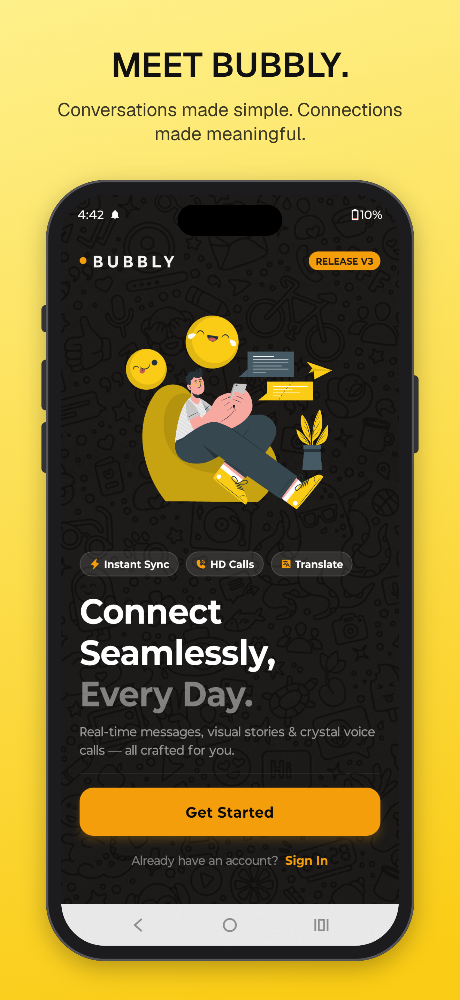
  
  
  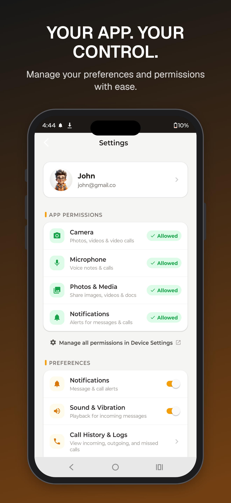
  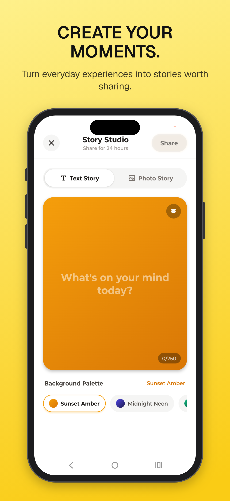
</p>

<p align="center">
  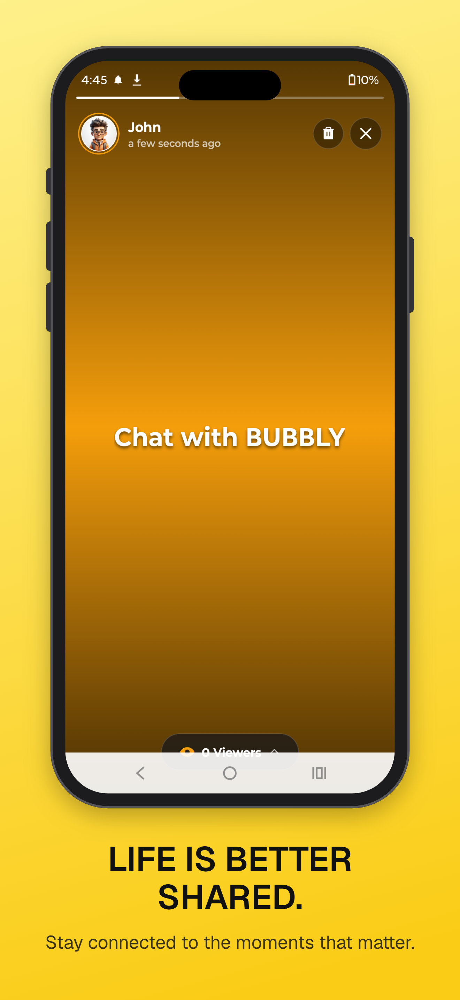
  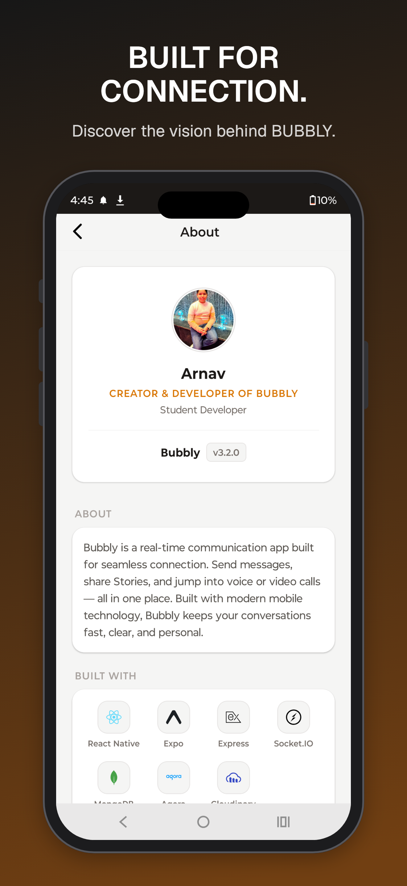
  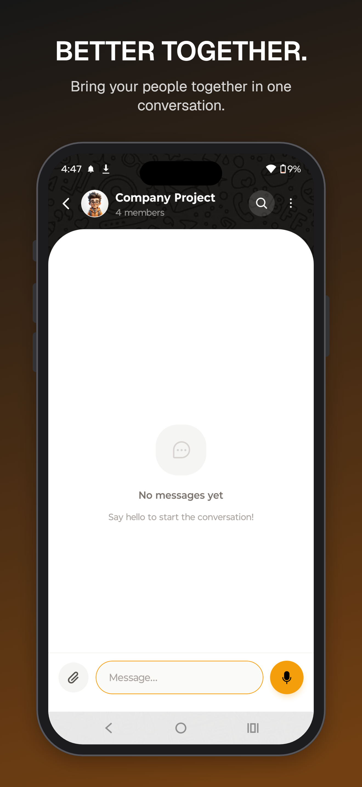
  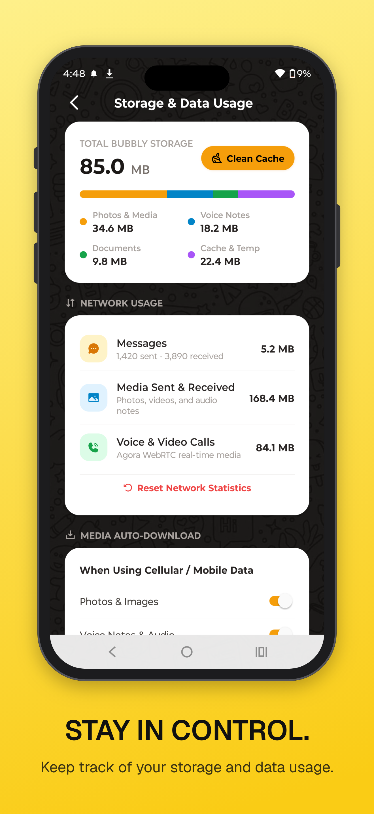
  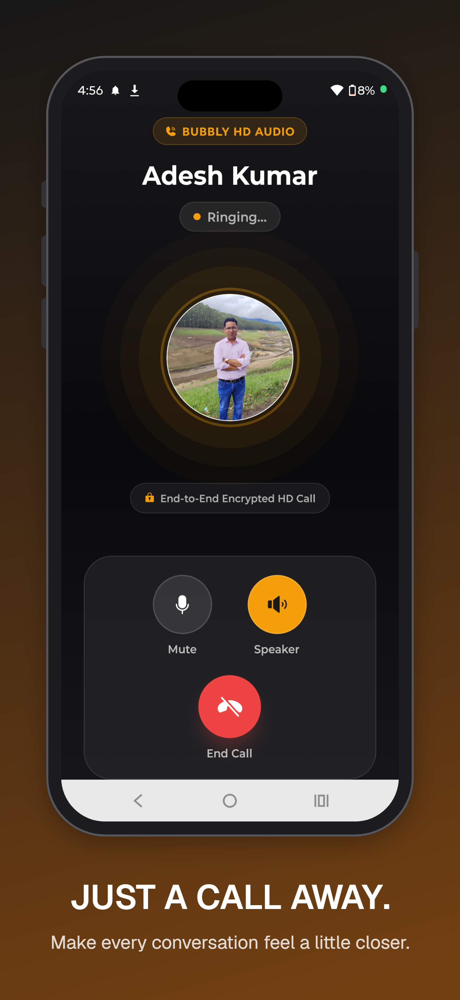
</p>

Explore the Bubbly mobile experience through the following **10 promotional screenshots**.

The gallery uses iOS/iPhone screenshot dimensions, with each image displayed at a consistent width while preserving its original aspect ratio. Screenshots are arranged in numerical order from `1.png` to `10.png`.

<p align="center">
  
  &nbsp;
  
  &nbsp;
  
  &nbsp;
  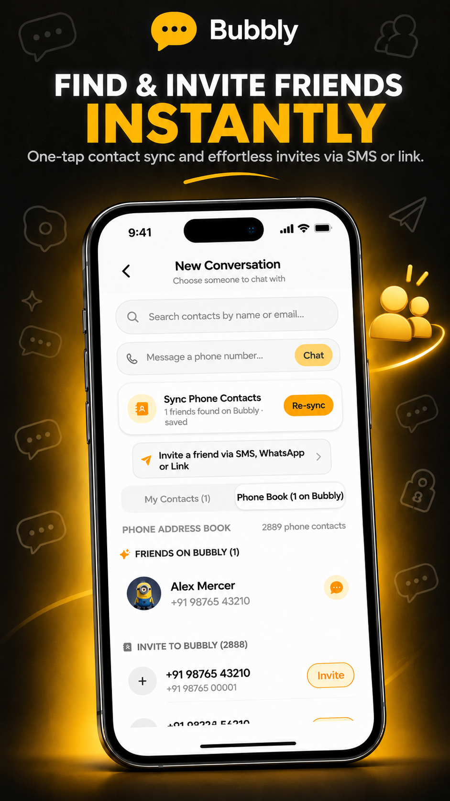
  &nbsp;
  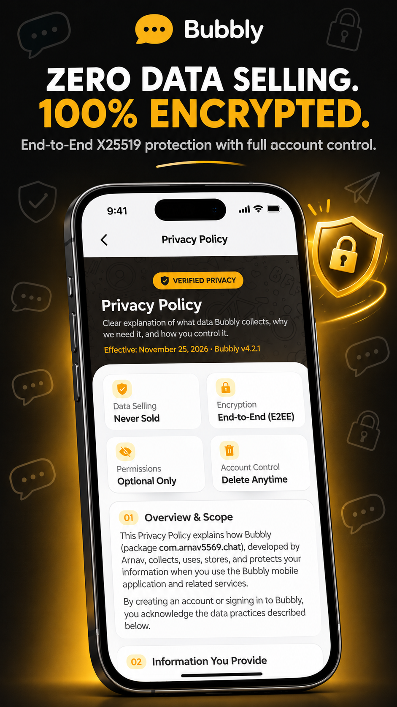
</p>

<p align="center">
  <sub>
    <strong>01 · Welcome</strong> &nbsp;·&nbsp;
    <strong>02 · Get Started</strong> &nbsp;·&nbsp;
    <strong>03 · Conversations</strong> &nbsp;·&nbsp;
    <strong>04 · Settings</strong> &nbsp;·&nbsp;
    <strong>05 · Story Studio</strong>
  </sub>
</p>

<br />

<p align="center">
  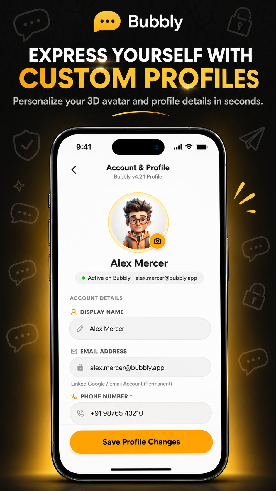
  &nbsp;
  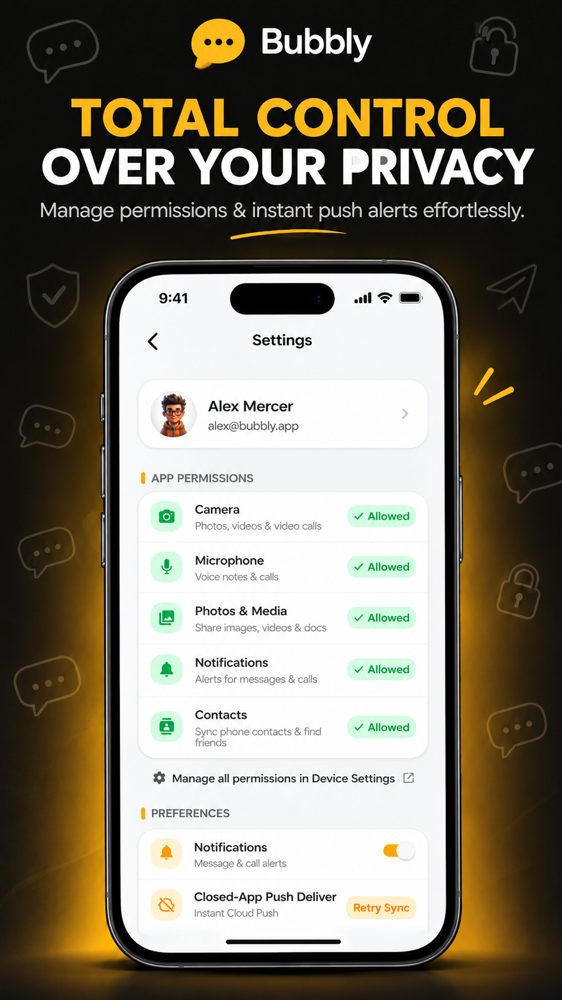
  &nbsp;
  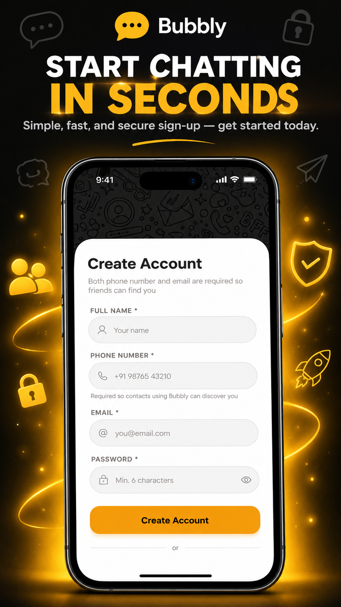
  &nbsp;
  
  &nbsp;
  
</p>

<p align="center">
  <sub>
    <strong>06 · Stories</strong> &nbsp;·&nbsp;
    <strong>07 · About Bubbly</strong> &nbsp;·&nbsp;
    <strong>08 · Group Chat</strong> &nbsp;·&nbsp;
    <strong>09 · Storage & Data</strong> &nbsp;·&nbsp;
    <strong>10 · Audio Call</strong>
  </sub>
</p>

---

## Features

Bubbly brings together messaging, social sharing, calling, and account management. The mobile interface uses a Honey Amber visual identity with warm backgrounds, golden accents, clear typography, and consistent component styling.

### Accounts and profiles

- User registration and login.
- JWT-based authentication.
- Password hashing with bcrypt.
- Profile information and avatar management.
- Profile photo selection and editing.
- Linked account information and profile status presentation.
- Shortcuts to Settings, How to Use Bubbly, About Bubbly, and Sign Out.

### Home dashboard and conversations

- Time-aware greeting that changes according to the time of day.
- Separate **Direct** and **Groups** conversation views.
- Conversation filters for **All**, **Unread**, and **Pinned** chats.
- Unread count badges and conversation counters.
- Search conversations with a clear action and result count.
- Quick access to profile and Settings.
- Floating action button for starting a new conversation or creating a group.
- Story bar with gradient rings for unseen stories and a quick-add action for the user's own story.
- Conversation previews with sent, delivered, and read indicators for messages sent by the current user.
- Preview labels for supported content such as voice notes, photos, and polls.
- Pinned conversation badges and unread message counters.
- Live online indicators on user avatars.

### Messaging

- Real-time one-to-one messaging.
- Group conversations.
- Message delivery acknowledgements.
- Read and delivery receipts.
- Replies and swipe-to-reply gestures with haptic feedback.
- Media and image attachments.
- Voice messages and playback controls.
- Voice playback speed selection at 1.0×, 1.5×, and 2.0×.
- Message translation into Spanish, with a switch between the original and translated text.
- In-chat search with match counts and previous/next navigation.
- Pinned messages with a banner and jump-to-message action.
- Saved messages.
- Scheduled messages and background processing.
- Conversation history and pagination.
- Unread message count and a floating scroll-to-bottom control when viewing older messages.
- Double-tap heart reaction with an animated visual response.
- Voice recording discard action for cancelling a recording before sending.
- Connection status feedback when the real-time socket disconnects.

### Groups

- Create group conversations.
- Search contacts by name or email when creating a conversation.
- Select multiple participants and remove selected participants before creating a group.
- Group avatar selection.
- Add and remove group members.
- Group administrators and configurable group permissions.
- Group descriptions and avatars.
- Group information management.
- Group system messages.
- Shared group gallery with separate **Media**, **Docs**, and **Links** views.

### Stories and Story Studio

- Create text-based stories.
- Create photo stories using the device media picker.
- Preview selected photos and add captions.
- Seven text-story background presets:
  - Sunset Amber
  - Midnight Neon
  - Cyber Mint
  - Berry Ruby
  - Deep Charcoal
  - Ocean Dusk
  - Warm Espresso
- Text alignment controls for left, centre, and right alignment.
- Character counter for text stories.
- Dedicated story viewer with segmented progress indicators.
- Pause story progress while pressing and resume on release.
- Quick emoji reactions: ❤️, 🔥, 😂, 👏, 😍, and 😮.
- Story replies with playback pausing while the reply interface is active.
- Story viewer count and viewer-list interface.
- Gradient story rings to distinguish unseen stories.

### Voice and video calls

- Voice calling and video calling through Agora integration.
- Incoming call handling.
- Call invitations, acceptance, rejection, and cancellation.
- In-call controls for mute, speakerphone, and ending a call.
- Animated avatar effects during voice calls.
- Call status and elapsed-duration display.
- Floating in-call video preview and camera-flip shortcut.
- Incoming call screen with animated acceptance action.
- Quick decline-and-message action from the incoming call interface.
- Call history.
- Cleanup of call vibration timers and audio resources when relevant screens are dismissed.

> The calling interface includes visual call-quality and security indicators. Such interface labels should not be interpreted as proof of a particular resolution or end-to-end encryption protocol unless the corresponding capability has been independently implemented and verified.

### Permissions and onboarding

- Multi-stage first-launch onboarding introducing the app's main capabilities.
- Native permission requests for:
  - **Camera:** camera capture and supported calling features.
  - **Microphone:** voice recording and supported calling features.
  - **Photos and media:** selecting photos and attachments.
  - **Notifications:** message and call notifications.
- Option to request supported permissions in sequence.
- **Skip for Now** flow so optional permissions do not prevent access to the application.
- Dedicated App Permissions section in Settings.
- Current operating-system permission status.
- Shortcut to device settings when a permission cannot be requested again in-app.
- Permission status refresh when the app returns to the foreground.
- Persisted onboarding completion across app restarts and logins.

### Design and mobile experience

- Honey Amber visual identity with amber and golden accents and warm neutral surfaces.
- Refined sent and received message bubbles.
- Consistent spacing, typography, corner radii, and shadows.
- Animated interactions for selected controls and reactions.
- Memoization of message and conversation list items to reduce avoidable re-renders.
- Tuned `FlatList` rendering and virtualization settings.
- Audio player cleanup when components unmount.
- Improved keyboard handling across Android and iOS layouts.
- Android hardware Back button handling for supported modals and overlays.
- `bubbly://` custom deep-link scheme.

---

## Technology stack

Bubbly uses separate but connected technology stacks for its mobile application, backend, and website.

| Layer | Technology |
|---|---|
| Mobile framework | React Native |
| Mobile development | Expo SDK 57 |
| Navigation | Expo Router |
| Language | TypeScript |
| UI and animations | React Native, Reanimated |
| API communication | Axios |
| Real-time client | Socket.IO Client |
| Backend runtime | Node.js |
| Backend framework | Express 5 |
| Database | MongoDB |
| Database ODM | Mongoose |
| Real-time server | Socket.IO |
| Authentication | JSON Web Tokens |
| Password hashing | bcryptjs |
| Voice and video | Agora |
| Audio | Expo Audio |
| Image selection | Expo Image Picker |
| Media storage | Cloudinary integration |
| Mobile builds | Expo Application Services (EAS) |
| Website framework | TanStack Start and React |
| Website tooling | Vite and TypeScript |

---

## Application architecture

Bubbly follows a client-server architecture. The mobile application communicates with the backend using authenticated REST requests and Socket.IO connections. The backend manages application logic, persistence, real-time events, and Agora token generation.

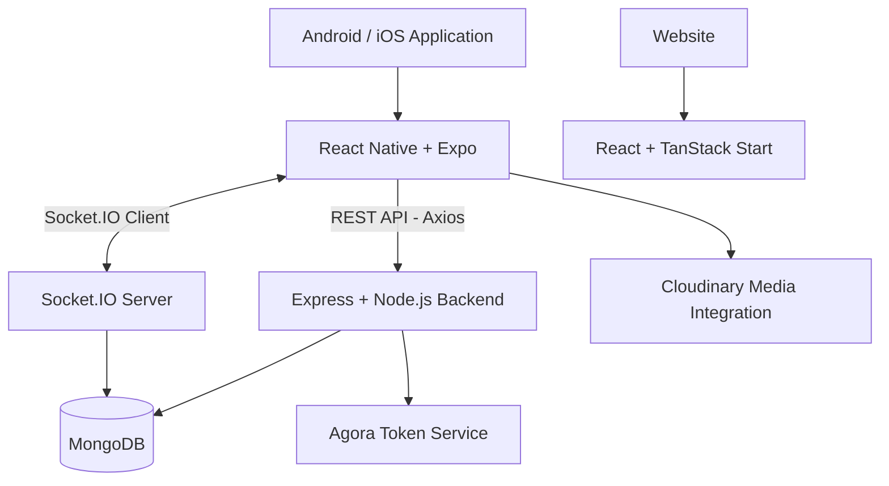

### Request and messaging flow

1. A user registers or signs in through the backend.
2. The backend validates the credentials and issues an authentication token.
3. The mobile application uses authenticated API requests and establishes a Socket.IO connection.
4. Socket events handle real-time messaging, delivery acknowledgements, group activity, and conversation updates.
5. MongoDB stores users, conversations, messages, calls, stories, and related application data.
6. The backend generates Agora tokens for supported calling workflows.
7. The mobile application integrates with media services for supported image and file workflows.

---

## Project structure

```text
bubbly-chatapp/
├── backend/
│   ├── config/
│   │   └── db.ts
│   ├── controllers/
│   │   ├── auth.controller.ts
│   │   ├── call.controller.ts
│   │   └── search.controller.ts
│   ├── middleware/
│   │   └── auth.ts
│   ├── modals/
│   │   ├── Call.ts
│   │   ├── Conversation.ts
│   │   ├── Message.ts
│   │   ├── Report.ts
│   │   ├── SavedMessage.ts
│   │   ├── ScheduledMessage.ts
│   │   ├── Story.ts
│   │   ├── TranslationCache.ts
│   │   └── User.ts
│   ├── routes/
│   │   ├── app.routes.ts
│   │   └── auth.routes.ts
│   ├── services/
│   │   ├── messageService.ts
│   │   └── scheduledWorker.ts
│   ├── socket/
│   │   ├── appEvents.ts
│   │   ├── callEvents.ts
│   │   ├── chatEvents.ts
│   │   ├── groupEvents.ts
│   │   ├── io.ts
│   │   ├── socket.ts
│   │   └── useEvents.ts
│   ├── utils/
│   │   ├── messageFormat.ts
│   │   ├── permissions.ts
│   │   ├── rateLimit.ts
│   │   └── token.ts
│   ├── index.ts
│   └── package.json
│
├── frontend/
│   ├── app/
│   │   ├── (auth)/
│   │   │   ├── login.tsx
│   │   │   ├── register.tsx
│   │   │   └── welcome.tsx
│   │   ├── (main)/
│   │   │   ├── about.tsx
│   │   │   ├── callScreen.tsx
│   │   │   ├── conversation.tsx
│   │   │   ├── createStory.tsx
│   │   │   ├── home.tsx
│   │   │   ├── incomingCall.tsx
│   │   │   ├── newConversationModal.tsx
│   │   │   ├── onboarding.tsx
│   │   │   ├── profileModel.tsx
│   │   │   ├── settings.tsx
│   │   │   └── storyViewer.tsx
│   │   ├── _layout.tsx
│   │   └── index.tsx
│   ├── components/
│   ├── constants/
│   ├── contexts/
│   ├── hooks/
│   ├── services/
│   ├── socket/
│   ├── utils/
│   ├── assets/
│   ├── app.json
│   ├── eas.json
│   └── package.json
│
├── website/
│   ├── public/
│   ├── src/
│   │   ├── components/
│   │   ├── hooks/
│   │   ├── lib/
│   │   ├── routes/
│   │   └── styles.css
│   └── package.json
│
├── web/
│   └── ...
│
├── screenshots/
│   ├── 1.png
│   ├── 2.png
│   ├── 3.png
│   ├── 4.png
│   ├── 5.png
│   ├── 6.png
│   ├── 7.png
│   ├── 8.png
│   ├── 9.png
│   └── 10.png
│
├── .gitignore
├── file-tree.txt
├── make_tree.py
└── README.md
```

The tree above shows the main application areas and selected files. Individual component and utility files may evolve as the project develops.

---

## Getting started

### Prerequisites

Before running Bubbly locally, make sure you have:

- Node.js and npm.
- Git.
- A MongoDB database or MongoDB Atlas connection.
- Expo development tooling.
- An Android emulator or physical Android device.
- macOS and Xcode for local iOS simulator builds.
- Agora and media-service credentials for the features being configured.

### 1. Clone the repository

```bash
git clone https://github.com/Tanjiro-77/bubbly-chatapp.git
cd bubbly-chatapp
```

### 2. Configure and run the backend

```bash
cd backend
npm install
```

Create a `.env` file inside the `backend` directory. See [Environment configuration](#environment-configuration) for the required values.

Start the development server:

```bash
npm run dev
```

For a production start, use the configured production script:

```bash
npm start
```

The backend root health-check endpoint is:

```text
GET /
```

Expected response:

```text
Server is running
```

### 3. Configure and run the mobile application

Open a second terminal from the repository root:

```bash
cd frontend
npm install
```

Create a `frontend/.env` file and configure the API base URL:

```env
EXPO_PUBLIC_API_URL=http://YOUR_LOCAL_IP:3000
```

Replace `YOUR_LOCAL_IP` with the LAN IP address of your development computer when testing on a physical device. The phone and development computer must be able to reach each other over the network.

Start Expo:

```bash
npx expo start
```

### 4. Configure and run the website

Open another terminal from the repository root:

```bash
cd website
npm install
npm run dev
```

Build the website:

```bash
npm run build
```

### 5. Configure and run the web application

The web application links directly with mobile users through the shared backend and Socket.IO network.

```bash
cd web
npm install
npm run dev
```

Build the web application for production:

```bash
npm run build
```

---

## Environment configuration

Bubbly uses environment variables to keep service configuration and private credentials outside the source code.

### Backend environment

Create `backend/.env`:

```env
PORT=3000
MONGO_URI=your_mongodb_connection_string
JWT_SECRET=your_long_random_secret
AGORA_APP_ID=your_agora_app_id
AGORA_APP_CERTIFICATE=your_agora_app_certificate
```

Use the actual configuration required by the services enabled in your deployment. If the application uses additional media-service configuration, follow the corresponding service integration in the source code rather than guessing variable names.

### Mobile environment

Create `frontend/.env`:

```env
EXPO_PUBLIC_API_URL=http://YOUR_LOCAL_IP:3000
```

For a production build, configure the production API URL using the environment mechanism supported by the project and EAS configuration.

> **Important:** Values prefixed with `EXPO_PUBLIC_` are bundled into the client application and must not contain private credentials, certificates, or server secrets.

---

## Available scripts

The following scripts are documented from the project's package configuration. Run them from the relevant directory.

### Frontend

| Command | Purpose |
|---|---|
| `npm start` | Start Expo development tooling. |
| `npm run android` | Start Android development. |
| `npm run ios` | Start iOS development. |
| `npm run web` | Start web development. |
| `npm run lint` | Run Expo linting. |

### Backend

| Command | Purpose |
|---|---|
| `npm run dev` | Start the backend in development mode. |
| `npm start` | Start the configured production server. |
| `npm test` | Run the backend test suite. |

### Website

| Command | Purpose |
|---|---|
| `npm run dev` | Start the website development server. |
| `npm run build` | Build the website for production. |

### Web Application

| Command | Purpose |
|---|---|
| `npm run dev` | Start the Bubbly web app development server on Vite. |
| `npm run build` | Compile TypeScript and bundle production assets with Vite. |
| `npm run preview` | Preview production build locally. |

---

## API overview

The backend uses Express routes and JWT authentication middleware.

### Authentication

Base path: `/auth`

| Method | Endpoint | Description |
|---|---|---|
| `POST` | `/auth/register` | Register a new user. |
| `POST` | `/auth/login` | Authenticate an existing user. |

### Application API

Base path: `/api`

| Method | Endpoint | Description |
|---|---|---|
| `GET` | `/api/search` | Search application data. |
| `POST` | `/api/translate` | Translate message text. |
| `POST` | `/api/call/token` | Generate an Agora RTC token. |
| `GET` | `/api/call/history` | Retrieve call history. |

The application routes listed above use authentication middleware. Request payloads and response structures are defined by the corresponding backend route and controller implementations.

---

## Real-time communication

Socket.IO powers Bubbly's real-time communication layer. The backend separates event handling into dedicated modules.

| Module | Responsibility |
|---|---|
| `chatEvents.ts` | Conversation and messaging events. |
| `groupEvents.ts` | Group management events. |
| `callEvents.ts` | Calling lifecycle events. |
| `appEvents.ts` | Application-level events. |
| `io.ts` | Socket room utilities. |
| `socket.ts` | Socket server initialisation. |

Examples of event names used by the application include:

```text
getConversations
newConversation
newMessage
messageAck
messageDelivered
getMessages
groupUpdated
addGroupMembers
removeGroupMember
call:invite
call:incoming
call:accept
call:reject
call:cancel
call:end
call:connected
```

These events support real-time conversation updates, messaging acknowledgements, group operations, and calling workflows.

---

## Build and distribution

Bubbly uses **Expo Application Services (EAS)** for cloud builds. Build configuration is maintained in `frontend/eas.json`.

Run the following commands from the `frontend` directory.

### Android APK — direct installation

```bash
eas build --platform android --profile production-apk
```

The `production-apk` profile is configured for an APK that can be installed directly on compatible Android devices. Once the build completes, download the `.apk` artifact from the EAS build page and distribute it through your chosen channel.

### Android AAB — app bundle

```bash
eas build --platform android --profile production
```

The production profile is configured for an Android App Bundle (`.aab`). An AAB is intended for app-store distribution workflows and is not normally installed by tapping the file like an APK.

### iOS build

```bash
eas build --platform ios --profile production
```

iOS builds require the appropriate Apple signing configuration. Private iOS installation and distribution are subject to Apple's supported distribution methods and signing/device requirements. An `.ipa` is not freely installable on every iPhone in the same way as an Android APK.

---

## Verification

The v3.0.0 development verification report recorded the following results:

| Verification | Reported result |
|---|---|
| Frontend TypeScript | Passed — 0 errors. |
| Backend test suite | Passed — 15 tests across 4 suites. |
| Backend TypeScript | Passed — 0 errors. |
| Website TypeScript | Passed — 0 errors. |
| Version configuration | `3.0.0`; Android version code `3`; iOS build number `3`. |

These are reported development checks. They do not replace installation and functional testing of the actual release build on physical devices. Android and iOS permissions, calling behaviour, animations, layout compatibility, and platform-specific interactions should be verified on their target devices.

---

## Security

Security-sensitive configuration must remain outside the public source code.

- Never commit `.env` files.
- Never expose MongoDB credentials or connection strings.
- Keep JWT secrets private.
- Keep Agora App Certificates private.
- Do not put private service credentials in `EXPO_PUBLIC_` variables.
- Use HTTPS for production API communication.
- Enforce authentication and authorisation on the backend.
- Remove passwords, tokens, and personal information from logs and screenshots before sharing them.
- Rotate credentials if they may have been exposed.

Public application identifiers and private service credentials must be treated differently.

---

## Contributing

Contributions, suggestions, and bug reports are welcome.

To contribute:

1. Fork the repository.
2. Create a feature branch.
3. Make your changes.
4. Test the affected functionality.
5. Commit with a clear, descriptive message.
6. Open a pull request explaining the change and how it was tested.

For major changes, open an issue first to discuss the proposed implementation.

---

## Reporting an issue

If you encounter a bug, please include:

- What you expected to happen.
- What actually happened.
- Steps to reproduce the issue.
- Relevant error messages or logs.
- Device model, operating-system version, and Bubbly app version where relevant.

Remove passwords, tokens, private URLs, and personal information before sharing logs or screenshots.

Report project issues through the [GitHub Issues page](https://github.com/Tanjiro-77/bubbly-chatapp/issues).

---

## License

The backend and frontend contain their own license metadata. Please refer to the license files in the respective directories for the applicable terms before using or redistributing those parts of the project.

---

## Developer

<div align="center">

### Arnav Khari

Creator and developer of Bubbly.

[GitHub Profile](https://github.com/Tanjiro-77) · [Source Repository](https://github.com/Tanjiro-77/bubbly-chatapp) · [Project Website](https://bubbly-chatapp.vercel.app/)

**Built with 💛, curiosity, and a lot of code.**

_Bubbly — Connect Beyond Messages._

</div>