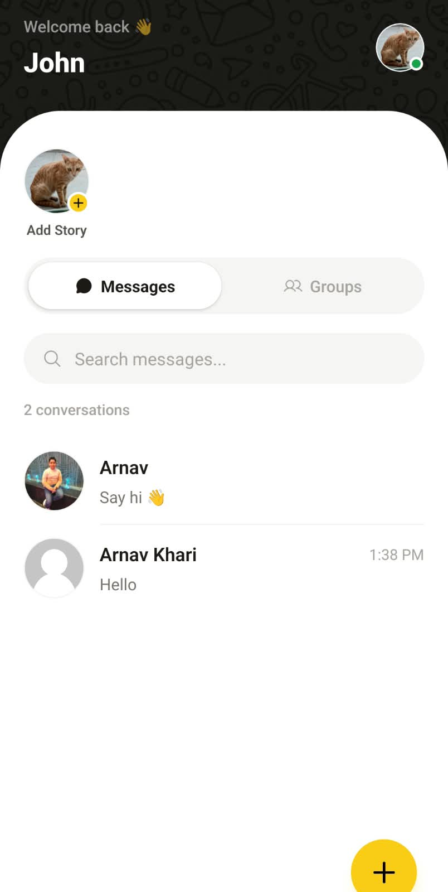
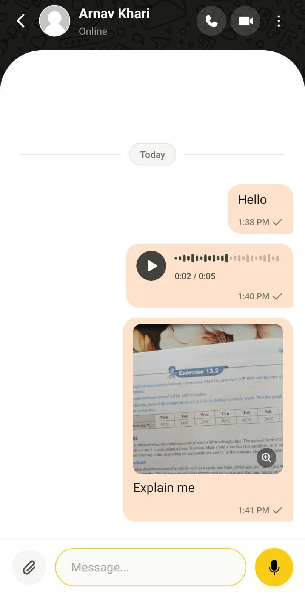
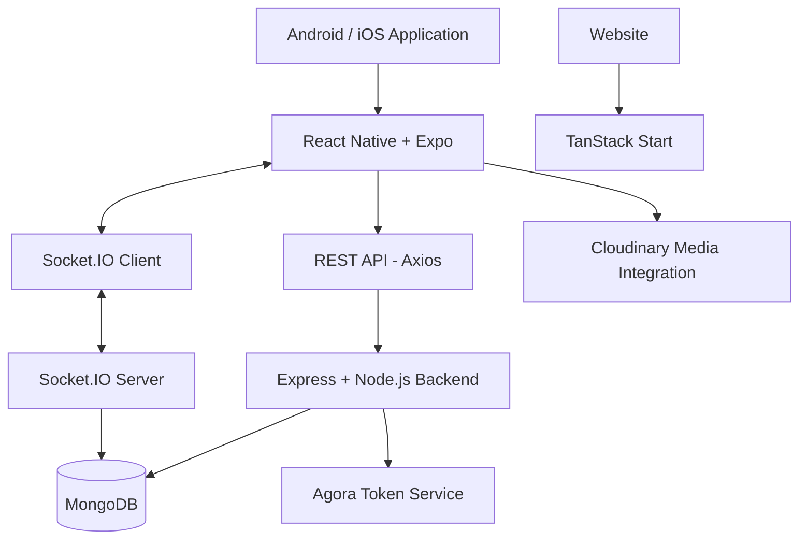

# Bubbly 💛

### Connect Beyond Messages.

<p align="center">
  <strong>A modern, full-stack real-time messaging application built with React Native, Expo, Node.js, MongoDB and Socket.IO.</strong>
</p>

<p align="center">
  <a href="https://github.com/Tanjiro-77/bubbly-chatapp">
    
  </a>
  <a href="https://bubbly-chatapp.vercel.app/">
    
  </a>
  
  
</p>

---

## 📖 About

**Bubbly** is a mobile-first messaging application designed to bring people closer through real-time communication.

It combines personal messaging, group conversations, stories, media sharing and audio/video calling in one application.

The project consists of three main parts:

- **Frontend:** A cross-platform mobile application built with React Native and Expo.
- **Backend:** A TypeScript-based server powered by Node.js, Express and MongoDB.
- **Website:** A separate web experience built with React, TypeScript and TanStack Start.

Bubbly is developed with a focus on real-time communication, modular architecture, user experience and practical full-stack engineering.

## 📱 Application Preview

The following screenshots are captured from the Bubbly mobile application.

### Authentication


### Home – Conversations and Stories



### Real-Time Messaging



### Story Creation


### Profile Management


---

## ✨ Features

### 💬 Messaging and Conversations

- Real-time one-to-one messaging.
- Group conversations.
- Message delivery acknowledgements.
- Read and delivery receipts.
- Reply to messages.
- Media and image attachments.
- Voice messages.
- Location and attachment metadata support.
- Conversation history and pagination.
- Saved messages.
- Message scheduling.
- Unread conversation counts.

### 👥 Groups

- Create group conversations.
- Add and remove group members.
- Group administrators.
- Group information management.
- Configurable group permissions.
- Group descriptions and avatars.
- Group system messages.

### 📸 Stories

- Create text-based stories.
- Share image stories.
- View stories through a dedicated story viewer.

### 📞 Audio and Video Communication

- Voice calling.
- Video calling.
- Incoming call handling.
- Call invitations and acceptance.
- Call rejection and cancellation.
- Call history.
- Agora-powered real-time communication.

### 👤 Authentication and Profiles

- User registration.
- User login.
- JWT-based authentication.
- Password hashing with bcrypt.
- Profile information.
- Avatar management.

### ⚙️ Additional Capabilities

- User search.
- Message translation endpoint.
- Scheduled message processing.
- Message rate limiting utilities.
- User permissions and access control.
- Conversation and call event handling.

---

## 🛠️ Technology Stack

Bubbly uses a separate technology stack for its mobile application, backend and website.

| Layer | Technology |
|---|---|
| Mobile framework | React Native |
| Mobile development | Expo SDK 57 |
| Navigation | Expo Router |
| Language | TypeScript |
| UI and animations | React Native, Reanimated |
| API communication | Axios |
| Real-time client | Socket.IO Client |
| Backend runtime | Node.js |
| Backend framework | Express 5 |
| Database | MongoDB |
| Database ODM | Mongoose |
| Real-time server | Socket.IO |
| Authentication | JSON Web Tokens |
| Password hashing | bcryptjs |
| Voice and video | Agora |
| Audio | Expo Audio |
| Image selection | Expo Image Picker |
| Media storage | Cloudinary integration |
| Build and distribution | EAS Build |
| Website framework | TanStack Start |
| Website tooling | Vite, TypeScript |

---

## 🏗️ Architecture

Bubbly follows a client-server architecture.



### How communication works

1. Users authenticate through the backend.
2. The backend verifies credentials and issues a JWT.
3. The mobile application uses authenticated requests and a Socket.IO connection.
4. Socket events handle real-time messaging and conversation updates.
5. MongoDB stores users, conversations, messages, calls and other application data.
6. Agora credentials are used by the backend to generate calling tokens.

---

## 📂 Project Structure

```text
bubbly-chatapp/
│
├── backend/
│   ├── config/
│   │   └── db.ts
│   │
│   ├── controllers/
│   │   ├── auth.controller.ts
│   │   ├── call.controller.ts
│   │   └── search.controller.ts
│   │
│   ├── middleware/
│   │   └── auth.ts
│   │
│   ├── modals/
│   │   ├── Call.ts
│   │   ├── Conversation.ts
│   │   ├── Message.ts
│   │   ├── Report.ts
│   │   ├── SavedMessage.ts
│   │   ├── ScheduledMessage.ts
│   │   ├── Story.ts
│   │   ├── TranslationCache.ts
│   │   └── User.ts
│   │
│   ├── routes/
│   │   ├── app.routes.ts
│   │   └── auth.routes.ts
│   │
│   ├── services/
│   │   ├── messageService.ts
│   │   └── scheduledWorker.ts
│   │
│   ├── socket/
│   │   ├── appEvents.ts
│   │   ├── callEvents.ts
│   │   ├── chatEvents.ts
│   │   ├── groupEvents.ts
│   │   ├── io.ts
│   │   ├── socket.ts
│   │   └── useEvents.ts
│   │
│   ├── utils/
│   │   ├── messageFormat.ts
│   │   ├── permissions.ts
│   │   ├── rateLimit.ts
│   │   └── token.ts
│   │
│   ├── index.ts
│   └── package.json
│
├── frontend/
│   ├── app/
│   │   ├── (auth)/
│   │   │   ├── login.tsx
│   │   │   ├── register.tsx
│   │   │   └── welcome.tsx
│   │   │
│   │   ├── (main)/
│   │   │   ├── about.tsx
│   │   │   ├── callScreen.tsx
│   │   │   ├── conversation.tsx
│   │   │   ├── createStory.tsx
│   │   │   ├── home.tsx
│   │   │   ├── incomingCall.tsx
│   │   │   ├── newConversationModal.tsx
│   │   │   ├── profileModel.tsx
│   │   │   ├── settings.tsx
│   │   │   └── storyViewer.tsx
│   │   │
│   │   ├── _layout.tsx
│   │   └── index.tsx
│   │
│   ├── components/
│   ├── constants/
│   ├── contexts/
│   ├── hooks/
│   ├── services/
│   ├── socket/
│   ├── utils/
│   ├── assets/
│   ├── app.json
│   ├── eas.json
│   └── package.json
│
├── website/
│   ├── public/
│   ├── src/
│   │   ├── components/
│   │   ├── hooks/
│   │   ├── lib/
│   │   ├── routes/
│   │   └── styles.css
│   └── package.json
│
├── screenshots/
│   ├── 1.png
│   ├── 2.png
│   ├── 3.png
│   ├── 4.png
│   └── 5.png
│
├── .gitignore
├── file-tree.txt
├── make_tree.py
└── README.md
```

---

## 🚀 Getting Started

### Prerequisites

Before running Bubbly locally, make sure you have:

- Node.js and npm.
- Git.
- MongoDB database or MongoDB Atlas.
- Expo development environment.
- An Android emulator or physical Android device.
- macOS and Xcode for local iOS simulator builds.
- Required Agora and media service credentials.

### 1. Clone the repository

```bash
git clone https://github.com/Tanjiro-77/bubbly-chatapp.git

cd bubbly-chatapp
```

### 2. Backend Setup

Navigate to the backend directory:

```bash
cd backend
```

Install dependencies:

```bash
npm install
```

Create a `.env` file in the backend directory.

Configure the required variables:

```env
PORT=3000
MONGO_URI=your_mongodb_connection_string
JWT_SECRET=your_secure_jwt_secret

AGORA_APP_ID=your_agora_app_id
AGORA_APP_CERTIFICATE=your_agora_app_certificate
```

Start the development server:

```bash
npm run dev
```

For production:

```bash
npm start
```

The backend exposes its root health-check endpoint at:

```text
GET /
```

Expected response:

```text
Server is running
```

### 3. Frontend Setup

Open another terminal and navigate to the frontend:

```bash
cd frontend
```

Install dependencies:

```bash
npm install
```

Configure the API base URL.

Create a frontend `.env` file:

```env
EXPO_PUBLIC_API_URL=http://YOUR_LOCAL_IP:3000
```

Replace `YOUR_LOCAL_IP` with the address of your development machine when testing on a physical device.

Start Expo:

```bash
npx expo start
```

Available scripts:

| Command | Purpose |
|---|---|
| `npm start` | Start Expo |
| `npm run android` | Start Android development |
| `npm run ios` | Start iOS development |
| `npm run web` | Start web development |
| `npm run lint` | Run Expo lint |

### 4. Website Setup

Open another terminal:

```bash
cd website
npm install
```

Start the development server:

```bash
npm run dev
```

Build the website:

```bash
npm run build
```

---

## 📡 API Overview

The backend uses Express routes and JWT authentication middleware.

### Authentication

Base path: `/auth`

| Method | Endpoint | Description |
|---|---|---|
| POST | `/auth/register` | Register a new user |
| POST | `/auth/login` | Authenticate an existing user |

### Application API

Base path: `/api`

| Method | Endpoint | Description |
|---|---|---|
| GET | `/api/search` | Search application data |
| POST | `/api/translate` | Translate text |
| POST | `/api/call/token` | Generate an Agora RTC token |
| GET | `/api/call/history` | Retrieve call history |

The application routes listed above use authentication middleware.

---

## ⚡ Real-Time Communication

Socket.IO powers Bubbly's real-time communication layer.

The backend separates event handling into dedicated modules:

| Module | Responsibility |
|---|---|
| `chatEvents.ts` | Conversation and messaging events |
| `groupEvents.ts` | Group management |
| `callEvents.ts` | Calling lifecycle |
| `appEvents.ts` | Application-level events |
| `io.ts` | Socket room utilities |
| `socket.ts` | Socket server initialization |

Examples of implemented event names include:

```text
getConversations
newConversation
newMessage
messageAck
messageDelivered
getMessages
groupUpdated
addGroupMembers
removeGroupMember
call:invite
call:incoming
call:accept
call:reject
call:cancel
call:end
call:connected
```

These events support real-time conversation updates, messaging acknowledgements, group operations and calling workflows.

---

## 🏗️ Build and Distribution

Bubbly uses Expo Application Services (EAS) for application builds.

From the `frontend` directory:

### Android APK

```bash
eas build --platform android --profile preview
```

### iOS

```bash
eas build --platform ios
```

iOS distribution and installation require appropriate Apple signing and distribution configuration.

The EAS build configuration is maintained in:

```text
frontend/eas.json
```

---

## 🔐 Security and Configuration

Security-sensitive configuration is kept outside the source code through environment variables.

Important practices:

- Never commit `.env` files.
- Never expose MongoDB credentials.
- Keep JWT secrets private.
- Keep Agora App Certificates private.
- Use HTTPS for production API communication.
- Validate authentication and authorization on the backend.
- Protect user data and private conversations.
- Rotate any credentials that have accidentally been exposed.

Public application identifiers and private service credentials should be treated differently.

---

## 🤝 Contributing

Contributions, suggestions and bug reports are welcome.

If you want to contribute:

1. Fork the repository.
2. Create a feature branch.
3. Make your changes.
4. Test the affected functionality.
5. Commit your changes with a descriptive message.
6. Open a pull request explaining the changes.

For major changes, open an issue first to discuss the proposed implementation.

---

## 🐛 Reporting Issues

If you encounter a bug:

- Describe what you expected to happen.
- Describe what actually happened.
- Include reproduction steps.
- Include relevant error messages or logs.
- Remove passwords, tokens and private user information before sharing logs.

Please use the repository's GitHub Issues section for project-related bug reports.

---

## 📜 License

The backend and frontend currently contain their own license metadata. Please refer to the license files in the respective directories for applicable terms.

---

## 👨‍💻 Author

**Arnav Khari**

Creator and developer of Bubbly.

- GitHub: [@Tanjiro-77](https://github.com/Tanjiro-77)
- Repository: [Bubbly Chat App](https://github.com/Tanjiro-77/bubbly-chatapp)
- Website: [bubbly-chatapp.vercel.app](https://bubbly-chatapp.vercel.app/)

---

<p align="center">
  <strong>Built with 💛, curiosity and a lot of code.</strong>
  <br/>
  <sub>Bubbly — Connect Beyond Messages.</sub>
</p>